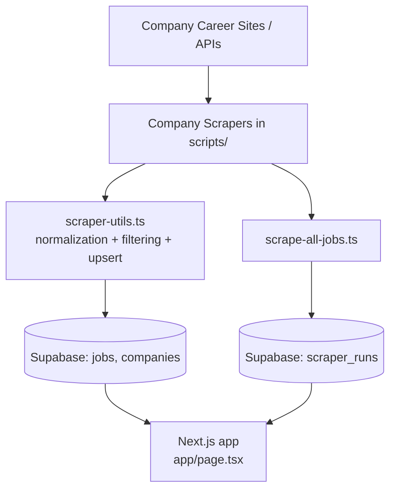
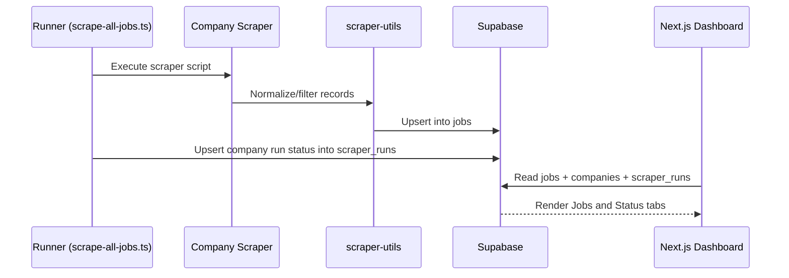

# JobPostings Dashboard

A Next.js + Supabase job aggregation dashboard with company-specific scrapers.

This project has two core parts:
- Web app to browse/filter job postings.
- Scraper pipeline that fetches jobs from company career sites/APIs and upserts into DB.

## Documentation Index

- [Scrapers Technical Guide](./scrapers.md)
- [Project Change Logs](./logs.md)

## Architecture



## Tech Stack

- Next.js 16 (App Router)
- React 19
- TypeScript
- Tailwind CSS + Radix UI
- Supabase (Postgres + JS client)
- Playwright (browser-driven scrapers)
- `tsx` (run TS scripts directly)

## Repository Structure

```text
app/
  page.tsx                     # Dashboard entry
  jobs/[id]/page.tsx           # Job detail
components/
  job-dashboard.tsx            # Jobs + Status views
  scraper-status-table.tsx     # Scraper status table
lib/
  job-data.ts                  # Frontend data access
  supabase.ts                  # Supabase client + DB types
scripts/
  scrape-all-jobs.ts           # Master runner
  scrape-*.ts                  # Company scrapers
  scraper-utils.ts             # Shared scraper helpers
scripts/sql/
  create-scraper-runs.sql      # SQL for scraper status table
```

## Database Model

Primary tables used by app/scrapers:
- `companies`
- `jobs`
- `scraper_runs`

`jobs` stores normalized postings with unique `external_job_id` per source job.

`scraper_runs` stores latest scraper execution state per company:
- `company_name`
- `status` (`Successful` | `Error` | `Partial`)
- `started_at`
- `completed_at`
- `duration_seconds`
- `error_message`
- `run_group_id`

Important behavior:
- `scrape-all-jobs.ts` uses `upsert(..., { onConflict: 'company_name' })`.
- This means one row per company in `scraper_runs`, updated on rerun.

## Prerequisites

- Node.js 18+
- npm (or pnpm/yarn; commands below use npm)
- Supabase project with required tables

## Environment Variables

Create `.env.local` in repo root:

```bash
NEXT_PUBLIC_SUPABASE_URL=...
NEXT_PUBLIC_SUPABASE_ANON_KEY=...
```

These are required by app and scrapers.

## Setup

```bash
npm install
```

## Create Scraper Status Table

Run this SQL once in Supabase SQL Editor:

- `scripts/sql/create-scraper-runs.sql`

It creates table + indexes + unique index on `company_name`.

## Run the Web App

Development:

```bash
npm run dev
```

Open `http://localhost:3000`.

Production build:

```bash
npm run build
npm run start
```

## Run Scrapers

### Run all scrapers (recommended)

```bash
npx tsx scripts/scrape-all-jobs.ts
```

This:
- runs all company scrapers sequentially,
- upserts jobs into `jobs`,
- updates each company row in `scraper_runs`.

### Run one scraper from master runner

```bash
npx tsx scripts/scrape-all-jobs.ts microsoft
npx tsx scripts/scrape-all-jobs.ts amazon
```

### Run individual scraper directly

```bash
npx tsx scripts/scrape-amazon-jobs.ts
npx tsx scripts/scrape-google-jobs.ts
npx tsx scripts/scrape-deloitte-jobs.ts
```

Note:
- Individual scraper scripts update `jobs`.
- `scraper_runs` is updated by `scrape-all-jobs.ts` (master runner).

## Supported Companies (Current)

- Amazon
- Microsoft (PCSX)
- Nvidia (PCSX / Workday path)
- Google
- Meta
- Apple
- IBM
- Salesforce
- Accenture
- Visa
- JPMorgan Chase
- Deloitte

## Scraper Rules Implemented

Common policy in this project:
- Prefer postings with valid `posted_date`.
- Use date window filtering (typically last 14 days, with future-date allowance where needed).
- If date is missing for a source, scrapers follow fallback logic:
- try secondary career URL (`careers_url_1`) where supported,
- otherwise scrape fallback pages (often first 20 pages) per company strategy.

All scrapers upsert by deterministic external IDs to prevent duplicate jobs.

## Status View in UI

Top bar has:
- `Jobs`
- `Status`

`Status` shows per company:
- Company Name
- Last Scraped
- Status
- Duration

Data source is `scraper_runs`.

## Useful Operational Commands

Test Supabase connectivity:

```bash
npx tsx scripts/test-supabase.ts
```

Run tests:

```bash
npm test
npm run test:watch
npm run test:coverage
```

Lint:

```bash
npm run lint
```

## End-to-End Data Flow



## Troubleshooting

- `Missing Supabase environment variables`:
- Ensure `.env.local` exists with both required keys.

- Scraper completes but no jobs inserted:
- Check `companies` table URL fields (`careers_url`, `careers_url_1`, etc.)
- Confirm filters/date window are not excluding all jobs.

- Status tab shows `Not Run`:
- Run master runner (`npx tsx scripts/scrape-all-jobs.ts`) at least once.
- Confirm `scraper_runs` table and unique index were created.

- Company status not updating on rerun:
- Verify unique index exists on `scraper_runs(company_name)`.

## Notes for Contributors

- Prefer using shared helpers in `scripts/scraper-utils.ts`.
- Keep external IDs stable for dedupe safety.
- Preserve fallback behavior around missing posting dates.
- For new companies, add scraper + company record + include in `SCRAPERS` list in `scripts/scrape-all-jobs.ts`.
