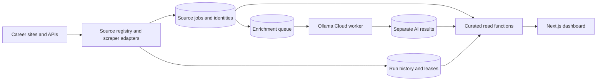

# JobPostings Dashboard

[Live dashboard](https://job-postings-dashboard.vercel.app/)

A Next.js and Supabase dashboard that collects recent public job postings from 26 companies. The dashboard reads paged public projections. Company scrapers save source data; a separate Ollama Cloud worker may add validated summaries and extracted facts.

## Architecture



The ingestion contract and source normalization live under `lib/modules/ingestion`. Search contracts and database reads live under `lib/modules/jobs`. The Ollama adapter and queue worker live under `lib/modules/enrichment`. Existing source-specific parsers remain in `scripts/` behind the shared runner and upsert path.

## Web App Features

- Compact job-search command area with result count, sort, quick filters, and `Grid` / `List` browsing modes.
- Filters for company, work type, department, date posted, employment type, visa sponsorship, and security clearance.
- Job cards and list rows expose separate `Details` and `Apply` actions plus compact pay, visa, and clearance signals when available.
- Job detail pages include a desktop sticky summary/sidebar and a mobile sticky apply action.
- Scraper status view supports company search, status chips, zero-job filtering, and sorting by status, last run, jobs, duration, or company.

## Setup and database migration

Use Node 24 and pnpm 9. Run `pnpm install --frozen-lockfile`, then copy `.env.example` to `.env.local` and fill in the Supabase credentials. The anon key is for curated reads; keep the service role key and `OLLAMA_API_KEY` on the server or in GitHub Actions secrets.

For a new database, apply `scripts/sql/0000-base-schema.sql` first and create company records with the career URLs required by their scrapers. On an existing project, retain its `jobs` and `companies` tables. Apply `scripts/sql/create-scraper-runs.sql` and `scripts/sql/ai-enrichment.sql` if needed. Then apply `scripts/sql/2026-10-10-architecture.sql`, `scripts/sql/2026-10-11-source-provenance.sql`, `scripts/sql/2026-10-12-source-summary.sql`, `scripts/sql/2026-10-13-inactive-retention.sql`, and `scripts/sql/2026-10-14-enrichment-health.sql` in order. The later migrations hide unproven scraper-written summaries, retain the date content first became inactive, and exclude superseded queue versions from pending health. Review the migrations against the actual Supabase schema before running them on production; they revoke direct anon/authenticated access to source and operations tables. The legacy `raw_job_payload` contains a normalized scraper snapshot, not the original HTTP response.

`lib/database.generated.ts` is generated from the versioned baseline and migrations on a disposable PostgreSQL database; `lib/supabase.ts` imports those types. Regenerate with `pnpm dlx supabase gen types typescript --db-url "$SUPABASE_DB_URL" --schema public > lib/database.generated.ts` after applying the migrations. The production database may contain legacy columns that require reconciliation.

If an existing production project already has migrations through `2026-10-11-source-provenance.sql`, apply the three newer files without dropping any tables: open **Supabase Dashboard → SQL Editor → New query**, copy the entire contents of `2026-10-12-source-summary.sql`, and click **Run**. Repeat for `2026-10-13-inactive-retention.sql`, then `2026-10-14-enrichment-health.sql`, waiting for each query to succeed before opening the next. Verify the retention column with `select inactive_since_at from public.jobs limit 1;`. The service role API key cannot execute these schema migrations through the app or scraper workflow.

## Run and operate

```bash
pnpm dev
pnpm exec tsx scripts/scrape-all-jobs.ts --maintenance-only
pnpm exec tsx scripts/scrape-all-jobs.ts --api-only --batch 0
pnpm exec tsx scripts/scrape-all-jobs.ts --browser-only --batch 0
pnpm exec tsx scripts/scrape-all-jobs.ts amazon
pnpm enrich:ai -- --limit 25 --dry-run
pnpm exec tsx scripts/ollama-smoke.ts
pnpm enrich:ai -- --limit 200
pnpm typecheck
pnpm test:unit
pnpm test:live
pnpm build
```

On a disposable local PostgreSQL database, run `TEST_DATABASE_URL=postgresql://... bash scripts/test-db-contracts.sh` to execute the migrations and concurrency checks. The optional `__tests__/db/scale-fixture.sql` adds 100 companies and 100,000 active jobs to that disposable database and reports local timing and payload bounds. On staging, run `pnpm exec tsx scripts/benchmark-search.ts` after loading 100,000 visible jobs. Run `pnpm exec tsx scripts/sample-ai-evaluation.ts` to prepare 50 live source snapshots for review, then run `pnpm exec tsx scripts/evaluate-ai.ts annotated-postings.json` after a human annotates them. The sample file is ignored by Git and must not be treated as ground truth until reviewed.

The scrape workflow runs lifecycle maintenance once, then eight source partitions with at most four jobs at a time. A source lease prevents overlapping runs. The enrichment workflow checks the GitHub repository variable `AI_ENRICHMENT_ENABLED`; leave it unset or `false` until the accuracy review passes. When enabled, it runs every four hours using `OLLAMA_API_KEY` from GitHub secrets and defaults to `gemma4:31b` from `OLLAMA_MODEL`.

Scrapers detect HTTP 403/429 and common challenge pages as source blocks. The default free fallback uses [Scrapling](https://github.com/D4Vinci/Scrapling): its HTTP fetcher tries blocked public GETs first, then its stealth browser fetcher tries blocked HTML pages. GitHub Actions installs it in the scraper workers. For local runs, install it with `python3 -m pip install -r scripts/requirements-scraping.txt`, run `scrapling install` for bundled browser support, and set `SCRAPLING_BROWSER_READY=true` when using the browser fallback for Node GETs. On a Mac with an installed Google Chrome, `SCRAPLING_REAL_CHROME=true` can use that browser instead. No paid scraping API is called in the default configuration.

`SCRAPING_FALLBACK=none` disables fallback. The paid [ScrapingBee API](https://www.scrapingbee.com/documentation/) remains available only with `SCRAPING_FALLBACK=scrapingbee` and `SCRAPINGBEE_API_KEY`; its signup credits are a trial, not a permanent free tier. Any fallback can still fail on sites that require interactive sessions or block the runner IP. Such blocks appear as errors or partial runs. A completed fetch with zero eligible postings remains successful.

The non-publishing Ollama smoke command consumes one or two calls from the same UTC application quota and prints only extraction metadata. The worker has a 200-job run cap, an eight request/minute pace, and a 1,200 request/day application cap in UTC. Format repair and retries consume quota. Failed enrichment does not hide source postings. Change the model by updating `ai_enrichment_settings` and enqueueing desired source hashes for the new model before changing `OLLAMA_MODEL`; otherwise the new worker will find no matching queue entries.

## Data rules

- The public browse window is the last 14 calendar days. Future dates and expired postings are excluded.
- Date provenance distinguishes source posting dates, first-seen dates, and unverified legacy dates. First-seen identities remain after content has been inactive for 180 days and its full row is purged. An ATS update timestamp is never treated as a first publication date.
- Unknown pay, sponsorship, clearance, work arrangement, or employment type appears as “Unknown.” AI facts require source excerpts; source descriptions and titles remain unchanged.
- Scraper guesses from legacy helper functions are discarded at the normalization boundary and are absent from the AI input. Only explicitly mapped company fields are stored as structured source facts; Ollama classifies every other factual field, including pay, sponsorship, and clearance. Scraper-written template summaries are discarded; a dedicated company summary needs explicit structured provenance. The public view lets structured source facts override AI and hides unproven historical categories and summaries.
- The dashboard queries one 20-job page by default, with a maximum of 100, and uses URL parameters for search and filters. The Status tab loads operational aggregates on demand.
- `scripts/sql/2026-10-10-architecture.sql` owns queue claims and result publication so a stale model response cannot overwrite a changed source posting.

## Validation before enabling cloud enrichment

Use an annotated set of at least 50 representative postings and adversarial cases. Require zero unsupported accepted pay, sponsorship, or clearance claims, at least 95% precision for factual extractions, and at least 90% coverage of explicitly stated target fields. Keep `AI_ENRICHMENT_ENABLED=false` until these checks pass. The repository's automated tests use mocked cloud responses and a disposable local PostgreSQL database; the 100,000-job benchmark and cloud evaluation still require staging data and an Ollama key.

The evaluation file is a JSON array of `{ "reviewed": true, "source": { ...normalized scraper fields... }, "expected": { ... } }`. Each `expected` object has nullable strings for `payRange`, `h1bSponsorship`, `securityClearance`, `locationType`, `employmentType`, and `department`, plus string arrays for `requiredQualifications` and `preferredQualifications`. Set `reviewed` to true only after verifying every expected value; use `null` only when the original posting does not explicitly state the fact. The evaluator adds six checked-in adversarial fixtures to the 50 reviewed real postings.

## Supported Companies (26)

| Company | Scraper | Date Source |
|---|---|---|
| Amazon | `scrape-amazon-jobs.ts` | API |
| Microsoft | `scrape-pcsx-jobs.ts` | API |
| Nvidia | `scrape-pcsx-jobs.ts` | Workday API |
| Google | `scrape-google-jobs.ts` | Detail page |
| Meta | `scrape-meta-jobs.ts` | First-seen |
| Apple | `scrape-apple-jobs.ts` | List + detail |
| IBM | `scrape-ibm-jobs.ts` | API |
| Salesforce | `scrape-salesforce-jobs.ts` | List page |
| Accenture | `scrape-accenture-jobs.ts` | API |
| Visa | `scrape-visa-jobs.ts` | API |
| JPMorgan Chase | `scrape-jpmorgan-jobs.ts` | API |
| Deloitte | `scrape-deloitte-jobs.ts` | List page |
| CVS | `scrape-workday-jobs.ts` | Workday API |
| AT&T | `scrape-workday-jobs.ts` | Workday API |
| Walmart | `scrape-workday-jobs.ts` | Workday API |
| CarMax | `scrape-workday-jobs.ts` | Workday API |
| Texas Instruments | `scrape-ti-jobs.ts` | Detail page |
| Staples | `scrape-staples-jobs.ts` | Detail page |
| Intuit | `scrape-intuit-jobs.ts` | First-seen |
| Datavant | `scrape-datavant-jobs.ts` | Greenhouse API |
| Wells Fargo | `scrape-wellsfargo-jobs.ts` | Detail page |
| Infosys | `scrape-infosys-jobs.ts` | First-seen |
| Goldman Sachs | `scrape-goldmansachs-jobs.ts` | First-seen |
| Wipro | `scrape-wipro-jobs.ts` | Detail page |
| Anthropic | `scrape-anthropic-jobs.ts` | Greenhouse API |
| OpenAI | `scrape-openai-jobs.ts` | Ashby API |
